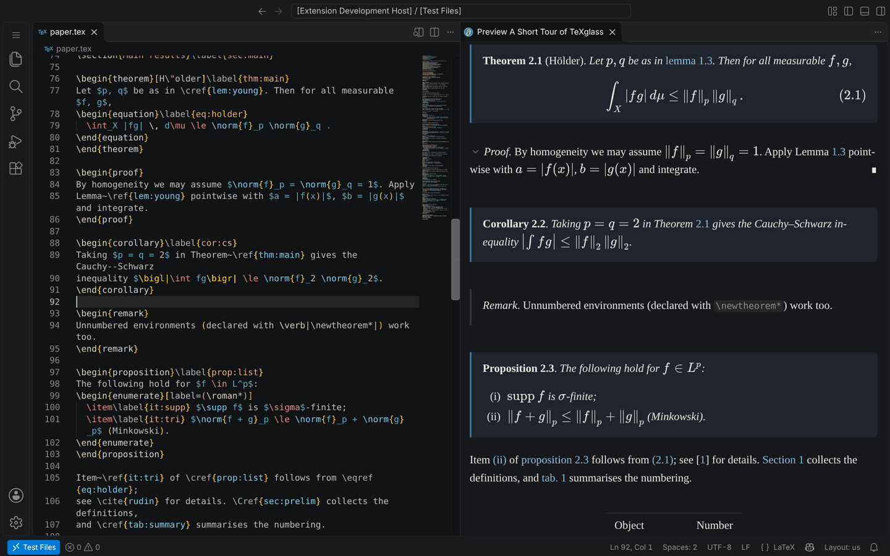
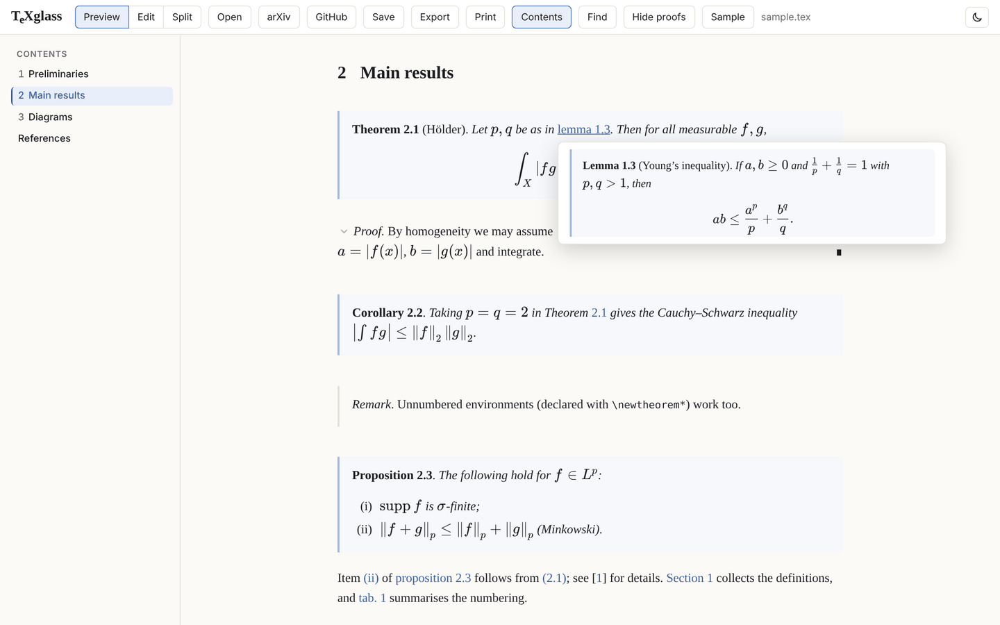
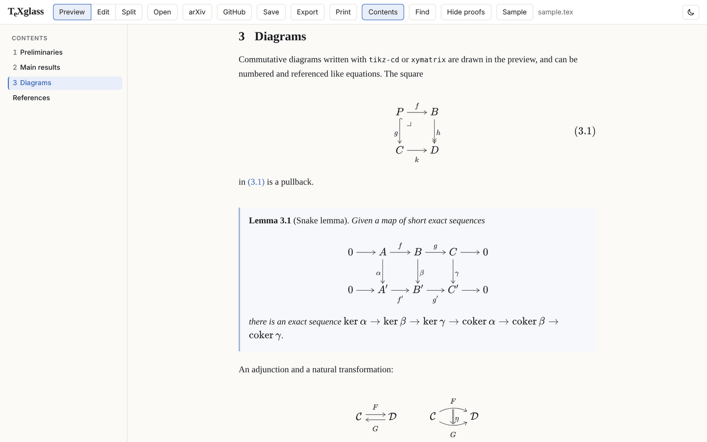
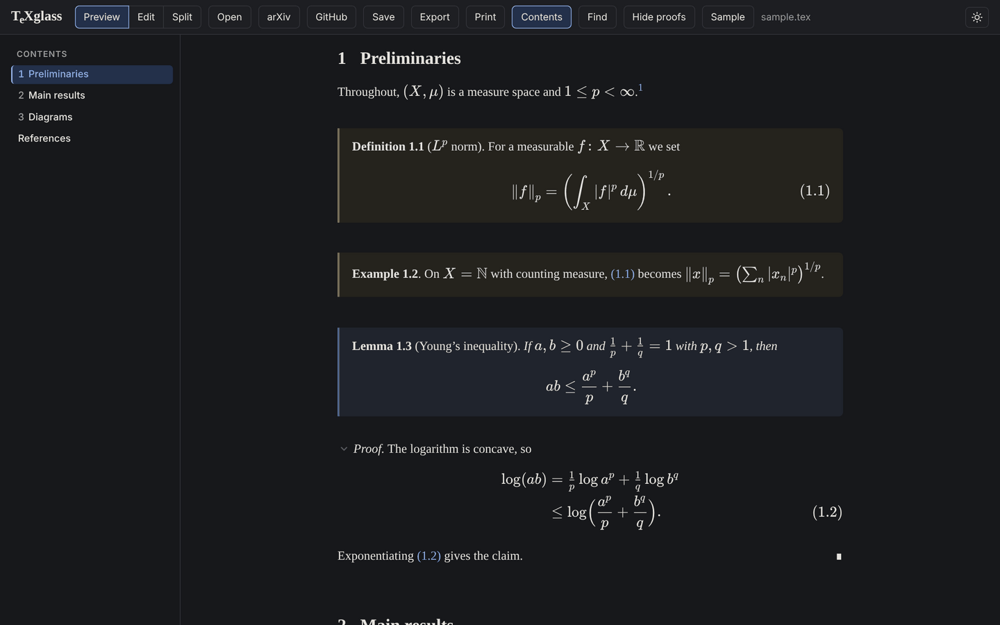

<p align="center">
  
</p>

<h1 align="center">TeXglass</h1>

<p align="center">
  <b>Read LaTeX like a paper, not like code.</b><br>
  A live preview for <code>.tex</code> files: KaTeX math, numbered theorems and equations, working references, and drawn diagrams. No TeX install, no compile step.
</p>

<p align="center">
  <a href="https://marketplace.visualstudio.com/items?itemName=klepo1.texglass"><b>VS Code extension</b></a> ·
  <a href="https://klepo0.github.io/TeXglass/"><b>Web viewer</b></a> ·
  <a href="https://github.com/klepo0/TeXglass/releases/latest"><b>arXiv browser extension</b></a>
</p>

<p align="center">
  
</p>

## Key features

Every feature, keyboard shortcut, VS Code command and setting is in the
**[TeXglass guide](docs/GUIDE.md)**.

The same reader runs in the VS Code extension, the web viewer and the arXiv
browser extension:

- **Reads like the paper**: KaTeX math, numbered theorems, equations and
  sections, working `\ref`/`\eqref`/`\cref`, citations and bibliographies
  (BibTeX, biblatex and amsrefs).
- **Hover previews** of references and citations; click to jump there.
- **Citation previews**: resting on a citation shows its bibliography entry,
  then the cited paper's title and abstract (looked up on DataCite and Crossref
  only when you hover, and kept for the visit), with **Open in TeXglass** when the
  paper is on arXiv. Offline, the bibliography entry is shown on its own.
- **What does this use?**: the small button by a theorem's heading lights up
  the results it rests on, directly or not, its proof and the equations it
  cites, and fades the rest of the page. Switch to **Used in** for the other
  direction, step through them, or press Esc to end it. Results reached only
  through a guessed link (see the Map below) get a dashed outline, and the
  cited works light up in the bibliography. The Map tab has the
  same thing as **Show what it uses**.
- **Reading progress**: a small marker by each theorem, lemma, definition and
  proof; click it to step through unread, skimmed, read and understood, and
  flag a result with **?** to ask about it. Contents shows how far each section
  has got ("4 of 7 understood"), suggests **What should I read next?** (the
  unread result the most others rest on) and lists the **?** results to copy;
  the Map colours results by status. Statuses are kept by `\label` with your
  notes, so they sync with them and survive a revised version of the paper.
  Switch it off in the **…** menu (VS Code: `texglass.readingProgress`).
- **Go to** any theorem, equation or section by number (Ctrl+G).
- **Trace** (a tab of the same bar): pick a theorem, lemma or definition and see only what it uses and what uses it.
- **Notation on hover**: rest the pointer on a formula to see where its
  notation comes from, the paper's macros (`\newcommand`) and symbols defined
  with `:=`, with a link to the first use or the definition.
- **Side panel** with three tabs: **Contents**, a **Map** of which lemmas each
  theorem uses, read from the `\ref`s in statements and proofs (a reference
  preview also says where a result is used), and a **Notation** index of the
  paper's macros and defined symbols. Rest the pointer on a result in
  the map, small or large, to preview its statement. Press **M** (outside a
  text field) to open the larger map, which fills the window: drag to move
  around, Ctrl + scroll or pinch to zoom, or use **−**, **+**, **0** and
  **F** (fit the whole map). Drag its edge to make it wider;
  the width is remembered, and on a narrow panel the tabs stack.
  The map also reads results named without a link ("Lemma 2.3" typed by
  hand, "the previous lemma"), drawn dashed as guesses, and links a cited
  equation to the result it sits in, or whose proof holds it. Solid lines are
  used in a proof, dotted ones only named in a statement; cited works
  (`\cite`) are leaves. Results are grouped by section, and chains of
  lemmas that serve a single result fold into it (+3 on the result shows
  them) once the map is big.
- **Handwritten notes look**, beside the light/dark button: notes on squared
  paper, or chalk on a board in the dark theme. All of it is worked out when you first ask for it, so rendering is
  not slowed down.
- **Click a formula** to copy its LaTeX.
- **Contents sidebar** that follows where you are; **fold** sections and
  proofs, or **Hide proofs** all at once.
- **Diagrams drawn**: `tikz-cd`, `xymatrix` and simple TikZ.
- **Margin notes**: `\marginpar` and `\todo` sit in a margin column beside
  their line. Drag the line between the text and the margin to make the
  margin wider or narrower; the width is remembered. Fold the margin away with
  the small arrow on that line, or by dragging the line all the way right; the
  notes stay as dots in the text, and clicking one (or dragging the arrow back
  out) opens the margin again. Whether it is folded is remembered too.
  The arrows under it (or **N** and **Shift+N**) jump to the next and previous
  note, your own notes included; the button below them narrows the jumps to
  margin notes, todo notes or your own.
- **Search** (Ctrl+F), **zoom**, and **light and dark themes**.
- **No TeX install, no compile step**, and fast on long papers.

## VS Code extension



Install **TeXglass** from the
[Marketplace](https://marketplace.visualstudio.com/items?itemName=klepo1.texglass)
(`ext install klepo1.texglass`), open a `.tex` file and press **Ctrl+K V**.

- **Live preview** beside the editor (Ctrl+K V) or in place (**Open
  Preview**, also in the Explorer's right-click menu), updated as you type,
  without saving.
- **Scroll sync** both ways, with a title-bar button and the
  `texglass.scrollSync` setting to turn it off.
- **Jump to source**: Ctrl+click or double-click in the preview puts the
  cursor on that word; **Ctrl+K J** jumps the preview to the cursor.
- **Multi-file documents**: `\input`, `\include`, `\subfile`, `\import`
  and `\includeonly`, live across files. Previewing a chapter shows the whole
  document (`% !TEX root`, subfiles, or the file that includes it).
- **Bibliographies** from your `.bib` files (BibTeX and biblatex), an
  existing `.bbl`, or amsrefs records (`\begin{bibdiv}…\bib{key}{article}{…}`)
  in the document itself.
- **Figures** in PNG, JPEG, SVG, GIF or WebP, with `\graphicspath`.
- **Highlighter and margin notes** of your own: select text to highlight it
  or write a note on it, or drag the note pad onto a line. They are saved
  beside the `.tex` in `name.texglass.json`, anchored to the text so they
  survive edits, and the `.tex` is never changed. **Export** and **Import**
  them as a file, and **sync** them between machines (see
  [Notes on every device](#notes-on-every-device)).
- **Handwritten notes look** (optional): **TeXglass: Toggle Handwritten
  Notes Look** shows the document in ink on squared, lined or plain paper, or
  as chalk on a board in dark mode. Pick the hand, the pen (ballpoint,
  fountain pen or black) and whether formulas are handwritten too in the
  `texglass.notes.*` settings. Print and HTML export keep the look.
- **Export to HTML**: one standalone page that works offline
  (`texglass.exportEmbedFonts`).
- **Print / Save as PDF**, laid out like a paper.
- Works in **github.dev and vscode.dev**: press `.` on any GitHub repo,
  preview, edit, commit.

Prefer a file? Every [release](https://github.com/klepo0/TeXglass/releases)
has a `.vsix` (**Extensions: Install from VSIX…**). More in
[vscode/README.md](vscode/README.md).

## Web viewer

**[klepo0.github.io/TeXglass](https://klepo0.github.io/TeXglass/)**: open or
drop a `.tex` file, search arXiv, paste an arXiv or GitHub link, or browse OpenAI's math
preprints. Nothing to install, and after your first visit it opens and renders
offline too (arXiv, GitHub and OAI preprints still need a connection).

<table>
  <tr>
    <td width="50%"><br><sub>Hover a reference to preview what it points to.</sub></td>
    <td width="50%"><br><sub><b>Go to</b> any theorem, equation or section by number.</sub></td>
  </tr>
  <tr>
    <td width="50%"><br><sub><code>tikz-cd</code>, <code>xymatrix</code> and simple TikZ, drawn.</sub></td>
    <td width="50%"><br><sub>Light and dark themes.</sub></td>
  </tr>
</table>

- **Open** (Ctrl+K, Cmd+K on a Mac) is one dialog for everything: search
  arXiv, type `github` and words to search GitHub, paste an arXiv id or a
  GitHub link, or pick a file from this computer.
- **Open** a file from this computer (Ctrl+O) or drag it onto the page. To bring in its
  `\input` files, local packages, bibliography and figures, open or drop its
  **folder** instead (Shift+click *Open*, or Ctrl+Shift+O), or choose several
  files at once; TeXglass finds the main file. In Chrome and Edge a folder
  chosen this way re-renders when you save any of its `.tex` files.
- **Highlights and notes** of your own, as in VS Code: select text for the
  highlighter bar, or drag the note pad onto a line. They are kept in this
  browser for each paper (an arXiv paper keeps its notes across versions).
  The `…` menu turns them off and on, and has **Export notes**, **Import
  notes…** and **Sync notes with GitHub…**.
- The **Contents** button shows the side panel; its **Notation** tab has a
  checkbox that turns notation on hover off and on. The pen button beside the
  light/dark button switches to the handwritten notes look.
- **arXiv search and import**: type words, a title or an author in the Open
  dialog to search arXiv (through [DataCite](https://datacite.org), which holds
  every arXiv DOI, with OpenAlex and Semantic Scholar as fallbacks, since
  arXiv's own search API can't be called from a web page), then click a result
  to open it. Or paste `2301.00001` or any arXiv link. Included files, the authors' own `.sty` macros, the
  bibliography (from the `.bbl`, BibTeX's or biber's, or else from the `.bib`
  files) and figures come along. `.eps` figures (common in older papers) are
  drawn as SVG by a small PostScript interpreter, pictures inside them included,
  and `.pdf` figures with pdf.js, loaded only for papers that have them. Also `?arxiv=2301.00001`.
- **GitHub search and import**: type `github` and words (`github thesis
  template`) in the Open dialog to search public repositories with LaTeX in
  them, then click one; or paste a link to a file, folder or repo of a public
  repository (`github owner/repo` works too); the main file, included files, `.bbl` or `.bib` and figures are found for
  you. Also `?gh=<link>`, a bookmarklet, and **Edit on GitHub**.
- **OpenAI math preprints**: the **OAI preprints** button lists the manuscripts in
  [openai/math](https://github.com/openai/math), searchable and filtered by
  discipline; click one to read its LaTeX source. Also `?preprint=<folder>`.
- **Three modes**: **Preview**, **Edit** (click any paragraph, theorem or
  equation to edit its LaTeX in place, Ctrl+E) and **Split** (source beside
  preview, scrolling together, resizable divider, Ctrl+Shift+E).
- **Editor**: LaTeX syntax colouring, autocomplete for commands, snippets,
  environments (your `\newtheorem`s too) and labels with their numbers,
  auto-closing math delimiters, and Tab to step out of brackets.
- The **…** button holds **Save**, **Export** and **Print**.
- **Save** back to the file (Ctrl+S) and **live reload** when the file changes
  on disk (Chrome and Edge).
- **Export** a standalone offline `.html` page.
- **Print** (Ctrl+P) as a clean paper-style PDF.
- **Status** counts undefined references and duplicate labels.

Run it locally with `npm start` (http://localhost:8000). It is a static page
with no build step.

**Privacy.** Your files and the papers you open never leave your browser.
The public site counts visits with [GoatCounter](https://www.goatcounter.com),
a cookieless counter: one request per visit with the site's path, the
referring site and the screen width, never a paper, file name or arXiv id.
It sets no cookies, stores nothing on your device, and is skipped when your
browser sends Do Not Track or Global Privacy Control. Local copies, the arXiv
browser extension, the VS Code extension and the command line count nothing.

### Notes on every device

Each paper's highlights and notes are a small file (`paper.texglass.json`),
keyed by the paper: its arXiv id, its GitHub path, or for a `.tex` file its
name and title. Notes are anchored to the text they mark, so they find their
place again in a revised paper.

- **Export / Import**: the web viewer's `…` menu, or **TeXglass: Export
  Highlights and Notes…** / **Import Highlights and Notes…** in VS Code.
- **Sync through GitHub**: your notes go to a private gist,
  `texglass-notes.json`, in your own GitHub account, and come back wherever you
  sign in. There is no TeXglass server. In VS Code, run **TeXglass: Sync
  Highlights and Notes with GitHub** and sign in with VS Code's own GitHub
  sign-in. In the web viewer and the browser extension, choose **Sync notes
  with GitHub…** and paste a token with only the `gist` scope (the dialog links
  to the page that makes one); it stays in that browser.
- **Without GitHub**: the browser extension also syncs notes with your
  browser's own sync (Chrome or Firefox), and VS Code with Settings Sync.

Notes changed on two devices at once are merged by note: the later edit of a
note wins, and a note deleted on one device stays deleted.

## arXiv browser extension

For **Chrome, Edge and Firefox** (Chrome/Edge 111 or later, Firefox 128 or later).

- **Toolbar button**, or **Alt+Shift+K**: on an arXiv abstract, PDF or HTML
  page, opens that paper in TeXglass; anywhere else, TeXglass with its arXiv
  search.
- **Right-click menu**: open any link to an arXiv paper, on any site.
- **Links on arxiv.org**: *View in TeXglass* on abstract pages, a *texglass*
  link in listings, and a floating button on HTML papers.
- **alphaXiv, HAL and ResearchGate**: a *View in TeXglass* button on paper
  pages whose paper is also on arXiv (HAL's own records, or an exact title
  match on arXiv).
- **Live preview on Overleaf**: a TeXglass panel beside Overleaf's editor
  that re-renders the open file as you (or your collaborators) type, scrolls
  along with the editor, and moves the cursor to whatever you click. It only
  reads the document; Overleaf's PDF stays the final version.
- **Self-contained**: papers open in a viewer bundled with the extension, so
  only arxiv.org needs to be reachable. The options can switch to the website.
- **Everything above**: hover previews, Go to, contents, click to copy and
  themes work on every paper.

Grab the zips from the latest
[release](https://github.com/klepo0/TeXglass/releases/latest); install steps
are in [browser/README.md](browser/README.md).

## Command line

```sh
npx texglass paper.tex -o paper.html
```

Same standalone page as **Export**. Add `--link-katex` to load KaTeX fonts
from a CDN instead of embedding them (~350 KB).

## What it understands

- **Math**: `$…$`, `\(…\)`, `\[…\]`, `equation`, `align`, `gather`,
  `multline`, `alignat`, `eqnarray`, mhequ's `equ` and `equs`, with `\tag`,
  `\nonumber`, `\notag`.
- **Macros**: `\newcommand`, `\renewcommand`, `\def` (delimited parameters
  too), `\let`, `\DeclareMathOperator`, in math and text, and those in a
  paper's own `.sty` files when imported from arXiv.
- **Theorems**: `\newtheorem` in all its forms, `\theoremstyle`, `proof` ∎.
- **Numbering and references**: sections, `\appendix`, `\numberwithin`,
  enumerate labels, figures, tables; `\ref`, `\eqref`, `\cref`, `\Cref`,
  `\autoref`, `\nameref`.
- **Structure**: `\maketitle`, abstract, lists, footnotes, `tabular`,
  `verbatim`, links.
- **Bibliographies**: `thebibliography`, `.bbl` (BibTeX or biber), `.bib`
  files (BibTeX and biblatex) and amsrefs records.
- **Diagrams**: `tikzcd` and `\xymatrix` (bends, shifts, 2-cells, arrow
  styles) and `tikzpicture`s, including `\clip`, hatching patterns, braces,
  pictures inside nodes, macros that hold paths, and `\resizebox` to the
  column width (pictures wider than the column shrink to fit). Tree symbols declared with
  `\DeclareSymbol` (as in regularity structures papers) are drawn inside
  formulas. Heavier TikZ shows its source.

Anything unknown is skipped gracefully.

## Development

The converter is `src/texglass.js`, dependency-free and shared by the web
viewer, the CLI and the VS Code extension. Diagrams live in `src/tikz.js` and
`src/diagrams.js`, editing aids in `src/editor.js`, HTML export in
`src/export.js`. `npm test` runs the tests.

Every night the [render dashboard](https://klepo0.github.io/TeXglass/dashboard/)
opens about 200 arXiv papers in the web viewer and lists what broke: maths
KaTeX could not render, missing figures, undrawn diagrams, papers that froze,
and slow loads, with what changed since the night before. See
[dashboard/README.md](dashboard/README.md) to run it yourself.

TeXglass was called TeXdown until November 2026; settings carry over.

## License

TeXglass is licensed under the
[PolyForm Noncommercial License 1.0.0](https://polyformproject.org/licenses/noncommercial/1.0.0).
See [LICENSE](LICENSE). You can use, change and share it for any
noncommercial purpose: personal use, research, teaching, and use by
universities, charities and other noncommercial organisations.

Commercial use needs a separate license. To ask about one, contact the
author, [@klepo0](https://github.com/klepo0), on GitHub or through an
[issue](https://github.com/klepo0/TeXglass/issues).

The license changed from MIT to PolyForm Noncommercial in November 2026,
from the release after 0.8.8. Versions up to and including 0.8.8 stay
under the MIT license for anyone who got a copy of them.

Bundled third-party code, such as KaTeX and pdf.js, keeps its own license.
