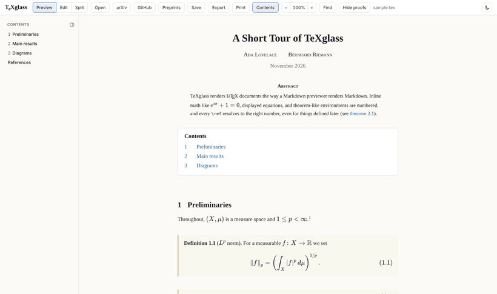
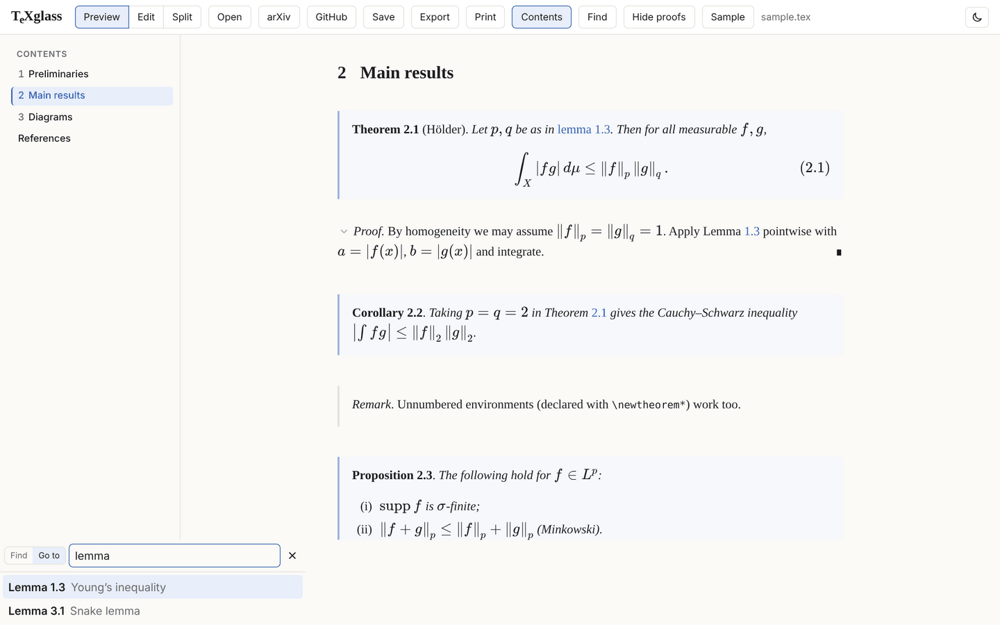

<p align="center">
  
</p>

<h1 align="center">TeXglass</h1>

<p align="center">
  <b>Read LaTeX like a paper, not like code.</b><br>
  A live preview for <code>.tex</code> files: KaTeX math, numbered theorems and equations, working references, and drawn diagrams. No TeX install, no compile step.
</p>

<p align="center">
  <a href="https://marketplace.visualstudio.com/items?itemName=klepo1.texglass"><b>VS Code extension</b></a> ·
  <a href="https://klepo0.github.io/TeXglass/"><b>Web viewer</b></a> ·
  <a href="https://github.com/klepo0/TeXglass/releases/latest"><b>arXiv browser extension</b></a>
</p>

<p align="center">
  
</p>

## VS Code extension


Install **TeXglass** from the
[Marketplace](https://marketplace.visualstudio.com/items?itemName=klepo1.texglass)
(`ext install klepo1.texglass`), open a `.tex` file and press **Ctrl+K V**.

- **Live** preview beside the editor, updated as you type.
- **Scroll sync** both ways; **Ctrl+click** in the preview jumps to the source.
- **Export to HTML** (one standalone page) and **Print / Save as PDF**.
- Works in **github.dev** too: press `.` on any GitHub repo, preview, commit.

Prefer a file? Every [release](https://github.com/klepo0/TeXglass/releases)
has a `.vsix` (**Extensions: Install from VSIX…**). More in
[vscode/README.md](vscode/README.md).

## Web viewer

**[klepo0.github.io/TeXglass](https://klepo0.github.io/TeXglass/)**: drop a
`.tex` file on the page, or paste an arXiv or GitHub link.

<table>
  <tr>
    <td width="50%"><br><sub>Hover a reference to preview what it points to.</sub></td>
    <td width="50%"><br><sub><b>Go to</b> any theorem, equation or section by number.</sub></td>
  </tr>
  <tr>
    <td width="50%"><br><sub><code>tikz-cd</code>, <code>xymatrix</code> and simple TikZ, drawn.</sub></td>
    <td width="50%"><br><sub>Light and dark themes.</sub></td>
  </tr>
</table>

- **arXiv import**: paste `2301.00001` or any arXiv link. Includes, the
  bibliography and figures come along. Also `?arxiv=2301.00001`.
- **GitHub import**: paste a link to a file, folder or repo; the main file is
  found for you. Also `?gh=<link>`, plus a bookmarklet.
- **Edit in place**: click any paragraph, theorem or equation to edit its
  LaTeX; numbering updates as you type. Or **Split** for source beside preview.
- **Navigate**: Contents sidebar, **Find** (Ctrl+F), **Go to** (Ctrl+G),
  fold sections and proofs, zoom.
- **Out**: **Export** a standalone offline `.html`, or **Print** as a clean
  paper-style PDF.
- **Autocomplete and syntax colouring** in the editor, including your own
  labels and `\newtheorem`s.

Run it locally with `npm start` (http://localhost:8000). It is a static page
with no build step.

## arXiv browser extension

For **Chrome, Edge and Firefox**. Click its toolbar button on any arXiv
abstract, PDF or HTML page, right-click an arXiv link, or use the **View in
TeXglass** links it adds to arxiv.org. Grab the zips from the latest
[release](https://github.com/klepo0/TeXglass/releases/latest); install steps
are in [browser/README.md](browser/README.md).

## Command line

```sh
npx texglass paper.tex -o paper.html
```

Same standalone page as **Export**. Add `--link-katex` to load KaTeX fonts
from a CDN instead of embedding them (~350 KB).

## What it understands

- **Math**: `$…$`, `\(…\)`, `\[…\]`, `equation`, `align`, `gather`,
  `multline`, `alignat`, `eqnarray`, with `\tag`, `\nonumber`, `\notag`.
- **Macros**: `\newcommand`, `\renewcommand`, `\def` (delimited parameters
  too), `\let`, `\DeclareMathOperator`, in math and text.
- **Theorems**: `\newtheorem` in all its forms, `\theoremstyle`, `proof` ∎.
- **Numbering and references**: sections, `\appendix`, `\numberwithin`,
  enumerate labels, figures, tables; `\ref`, `\eqref`, `\cref`, `\Cref`,
  `\autoref`, `\nameref`.
- **Structure**: `\maketitle`, abstract, lists, footnotes, `thebibliography`
  and `.bbl`, `tabular`, `verbatim`, links.
- **Diagrams**: `tikzcd` and `\xymatrix` (bends, shifts, 2-cells, arrow
  styles) and simple `tikzpicture`s. Heavier TikZ shows its source.

Anything unknown is skipped gracefully.

## Development

The converter is `src/texglass.js`, dependency-free and shared by the web
viewer, the CLI and the VS Code extension. Diagrams live in `src/tikz.js` and
`src/diagrams.js`, editing aids in `src/editor.js`, HTML export in
`src/export.js`. `npm test` runs the tests.

**Releasing**: bump `version` in `vscode/package.json`, merge, then push a
matching tag from main (`git tag v0.9.0 && git push origin v0.9.0`). The
[Release workflow](.github/workflows/release.yml) builds the `.vsix` and
browser zips, publishes a GitHub Release, and publishes to the VS Code
Marketplace (trusted publishing) and to Open VSX when `OVSX_PAT` is set.

TeXglass was called TeXdown until November 2026; settings carry over.

## License

MIT. See [LICENSE](LICENSE).
