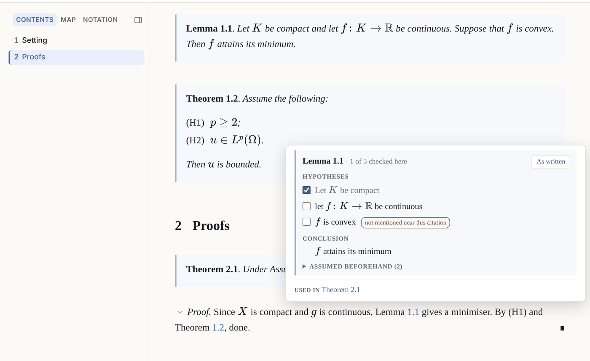
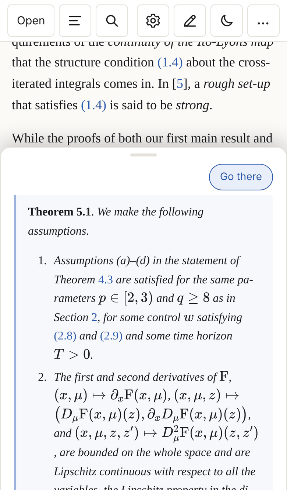

  

<h1 align="center">TeXglass</h1>

  <b>Read LaTeX like a paper, not like code.</b> 
  For mathematicians and scientists reading arXiv papers or writing LaTeX:
  the math rendered, theorems numbered, references live, diagrams drawn.
  Then the smart part: <b>What does this use?</b> lights up everything a theorem
  rests on, a <b>dependency map</b> shows how the results fit together, a
  <b>hypothesis checker</b> lists what a cited lemma needs, and <b>notation on
  hover</b> tells you what a symbol means. No TeX install, no compile step.

  
  
  
  
  

  <a href="https://klepo0.github.io/TeXglass/?arxiv=2106.10340"><b>▶ Try it now</b></a>: <i>Rough stochastic differential equations</i> from arXiv, opened in the web viewer.

  

## Why TeXglass

- **Math that reflows.** Papers read like the published version, in light or
  dark, at any width, with every `\ref` a link you can hover.
- **See how a paper fits together.** A map of which lemma each theorem uses,
  "What does this use?" on any result, and a checklist of the hypotheses of
  each cited lemma.
- **Read anywhere, phones and tablets included.** Swipe-in panels, previews
  that open on a tap, notes written with Apple Pencil or a stylus, and a
  home-screen app that works offline.
- **Your notes go with you.** Highlights, margin notes, reading progress and
  your list of saved papers sync through your own GitHub gist, with no
  TeXglass server.
- **Works offline and stays private.** Save papers for a train or a plane and
  read them with no connection. Your files never leave your browser or editor.

## Get started

| | How | Best for |
| --- | --- | --- |
| **[Web viewer](https://klepo0.github.io/TeXglass/)** | Open the link. Search arXiv, paste an arXiv or GitHub link, or drop a `.tex` file. | Reading papers in any browser |
| **[VS Code extension](https://marketplace.visualstudio.com/items?itemName=klepo1.texglass)** | `ext install klepo1.texglass`, open a `.tex` file, press **Ctrl+K V**. Also on [Open VSX](https://open-vsx.org/extension/klepo1/texglass). | Writing LaTeX with a live preview |
| **[Home Screen app](docs/GUIDE.md#on-phones-and-tablets)** | On a phone or tablet, open the [web viewer](https://klepo0.github.io/TeXglass/), then Share → **Add to Home Screen** (iPhone, iPad) or **Install TeXglass as an app** in the **…** menu (Android). | Reading on the go, offline too |
| **[arXiv browser extension](browser/README.md)** | For **Chrome, Edge and Firefox**. Download the zips from the [latest release](https://github.com/klepo0/TeXglass/releases/latest) and follow the install steps. | One click from arXiv, alphaXiv, HAL, ResearchGate and Overleaf |

There is also a command line tool: `npx texglass paper.tex -o paper.html`
writes one standalone page.

## Features

Everything below is described in full, with every shortcut, command and
setting, in the **[TeXglass guide](docs/GUIDE.md)**.

### Read

- **Rendered like the paper**: KaTeX math, numbered theorems, equations and sections, BibTeX, biblatex and amsrefs bibliographies.
- **Diagrams drawn**: `tikz-cd`, `xymatrix` and TikZ pictures.
- **Hover previews** of references, footnotes, citations (with the cited paper's abstract) and cited theorems.
- **Go to** any theorem, equation or section by number, and **Back** to where you were after any jump.
- **Contents** that follows you, folding sections and proofs, search, zoom, light and dark.
- **Open anything**: arXiv search, GitHub repositories, OpenAI's math preprints, or local files and folders.

### Understand

- **Dependency map** of which results each theorem uses, read from the paper's own references; double-click a result to jump to it.
- **What does this use?** lights up everything a result rests on, or everything that uses it.
- **Hypothesis checker**: a cited lemma's hypotheses split out, each with a box to tick.
- **Notation on hover** and a **notation index** of the paper's macros and defined symbols.
- **Reading progress** per result and section, with **What should I read next?**

### Study

- **Highlights and margin notes** of your own, anchored to the text so they survive a revised version.
- **Handwritten notes look**: ink on squared paper, or chalk on a board in dark mode.
- **Write with a pen** in the margin on a tablet.
- **Show selected results** and **print** exactly that view.
- **Save for offline**: keep papers on your device and find them under **Saved papers**.
- **Sync** notes through a private GitHub gist, your browser's sync or VS Code Settings Sync.

### Write

- **Live preview in VS Code** as you type, without saving, across multi-file documents.
- **Scroll sync** both ways and **jump to source** from the preview.
- **Live preview beside Overleaf's editor** from the browser extension.
- **Edit in the web viewer** with in-place editing, a split view and LaTeX autocomplete.
- **Export** a standalone offline HTML page, or **print** to PDF laid out like a paper.

## A closer look

<table>
  <tr>
    <td width="50%"> The <b>dependency map</b>: which result rests on which.</td>
    <td width="50%"> The <b>hypothesis checker</b> in a reference preview.</td>
  </tr>
  <tr>
    <td width="50%"> On a <b>phone</b>: a tap opens the preview as a sheet.</td>
    <td width="50%"> The <b>VS Code</b> preview beside the source.</td>
  </tr>
  <tr>
    <td width="50%"> <code>tikz-cd</code>, <code>xymatrix</code> and TikZ, drawn.</td>
    <td width="50%"> <b>Go to</b> any theorem, equation or section by number.</td>
  </tr>
</table>

## Reliability, privacy and offline use

- **Tested every night**: the [render dashboard](https://klepo0.github.io/TeXglass/dashboard/)
  opens about 200 arXiv papers across maths, physics and computer science and
  lists what broke.
- **Private**: your files and papers stay in your browser or editor. Citation
  previews ask DataCite and Crossref only when you hover, and can be switched
  off. The extensions and the command line count nothing; the public website
  counts visits with a cookieless counter. Details in the
  [guide](docs/GUIDE.md#offline-and-privacy).
- **Offline**: the VS Code extension and the command line work fully offline,
  and the web viewer does too after your first visit. Papers you **Save for
  offline** open without a connection.
- **What LaTeX it understands** is listed in the
  [guide](docs/GUIDE.md#what-latex-it-understands). Anything unknown is skipped
  gracefully.

## Contribute

Found a paper that renders badly? [Open an issue](https://github.com/klepo0/TeXglass/issues)
with its arXiv id. To work on the code, see [CONTRIBUTING.md](CONTRIBUTING.md);
`npm start` serves the web viewer at http://localhost:8000 and `npm test` runs
the tests.

## License

[PolyForm Noncommercial 1.0.0](LICENSE): free for any noncommercial use,
including personal use, research, teaching, and universities, charities and
other noncommercial organisations. Commercial use needs a separate license;
ask [@klepo0](https://github.com/klepo0) on GitHub or through an
[issue](https://github.com/klepo0/TeXglass/issues). Versions up to and
including 0.8.8 stay under the MIT license for anyone who got a copy of them.
Bundled third-party code, such as KaTeX and pdf.js, keeps its own license.
