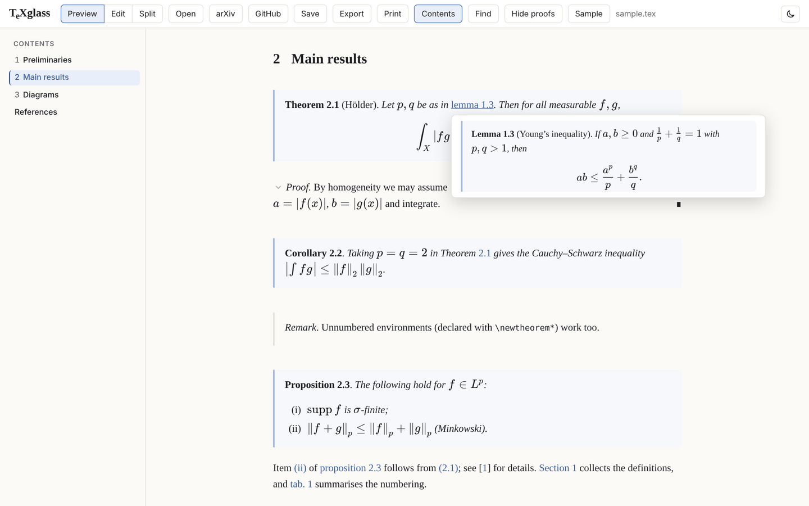

# TeXglass Preview for VS Code

Preview LaTeX files beside the editor the way VS Code previews Markdown: math
rendered with [KaTeX](https://katex.org), and sections, equations and
theorem-like environments numbered the way LaTeX would number them, with
`\ref`, `\eqref` and `\cref` resolving to those numbers. No TeX installation
is needed, and the preview updates as you type, without saving.


Hover a reference to see what it points to, and jump to a theorem by its number:




Commutative diagrams (`tikz-cd`, `xymatrix`) are drawn in the preview:


## Use

- Open a `.tex` file and click the preview icon in the editor title bar, or run
  **TeXglass: Open Preview to the Side** (Ctrl+K V, Cmd+K V on a Mac).
  **TeXglass: Open Preview** opens it in the current editor group instead;
  it is also in the Explorer's right-click menu for `.tex` files.
- The preview follows the LaTeX file you are editing, and scrolls along with
  the editor (and the editor with the preview). The link button in the
  preview's title bar turns that off and on again (or **TeXglass: Toggle
  Scrolling with the Editor**, or the `texglass.scrollSync` setting).
- **Jump to the cursor**: press **Ctrl+K J** (Cmd+K J on a Mac) in a `.tex`
  file, or right-click and choose **TeXglass: Jump Preview to Cursor**, to
  bring the spot you are editing to the middle of the preview, highlighted
  for a moment. It opens the preview if needed, and works in files pulled in
  with `\input` or `\include`. To use another key, search for
  `texglass.showCursor` in Keyboard Shortcuts (Ctrl+K Ctrl+S).
- **Ctrl+click** (Cmd+click on a Mac) anywhere in the preview, or
  double-click, to put the cursor at that spot in the source: on the word you
  clicked, or at the start of the formula.
- **Click a formula** to copy its LaTeX source, as written in your file
  (labels left out). "Copied LaTeX" shows by the pointer. The
  `texglass.clickToCopyMath` setting turns this off.
- **Notation on hover**: rest the pointer on a formula to see where its
  notation is defined: the document's own macros (with their definition and
  first use) and symbols defined with `:=`. The `texglass.notationHover`
  setting turns it off.
- The contents sidebar has three tabs: **Contents**, **Notation** (the
  document's macros and defined symbols with their first uses) and **Map**
  (which lemmas each theorem uses, from the `\ref`s in its statement and
  proof). **TeXglass: Show Notation Index** and **TeXglass: Show Dependency Map
  of the Results** open those tabs. Drag the sidebar's edge to resize it; the
  width and tab are remembered. Hovering a
  reference to a result also says what it uses and where it is used. These are
  worked out from the preview only when asked for, so rendering is as fast as
  before.
- **Fold** sections and proofs with the arrow beside them, or by clicking a
  section heading or a folded proof. Folds are remembered.
- The buttons in the preview's title bar: **Contents** shows a sidebar of the
  sections that highlights the one you are reading (on a narrow preview it
  opens as a drawer); **Hide proofs** / **Show proofs** folds or unfolds every
  proof; the link button turns scrolling with the editor off and on; and the
  half-moon button switches the preview between **light and dark**
  (**TeXglass: Toggle Light/Dark Preview**; the `texglass.previewTheme` setting
  can also be set back to `auto`, which follows VS Code's theme).
- **Handwritten notes look**: the pen button in the preview's title bar, next
  to the light/dark one, or **TeXglass: Toggle Handwritten Notes Look**, shows the document as notes in blue ink on squared
  paper, and as chalk on a board in dark mode. Choose the paper (`grid`, `lined`
  or `plain`) with `texglass.notes.paper`, the hand (Kalam, Caveat, Patrick
  Hand or Architects Daughter) with `texglass.notes.handwriting`, and whether
  formulas are handwritten too with `texglass.notes.handwrittenMath`. The ink
  looks real, with slightly ragged strokes that thin and pool along a line and
  bleed a little into the paper; pick the pen (blue ballpoint, royal-blue
  fountain pen or black) with `texglass.notes.ink`, or turn the effect off with
  `texglass.notes.realisticInk`. **Export to HTML** and **Print** (and so
  Save as PDF) keep the look while it is on: the paper fills every printed
  page, always light, with the same hand and pen. Printed ink is always flat,
  so a PDF stays small and its text can be selected. The fonts are bundled (SIL
  Open Font License), so it works offline.
- **Margin notes**: `\marginpar`, `\marginnote` and `\todo` (todonotes, with
  its `color=`) show in a column to the right of the text, level with the line
  they were written on, as on paper. `\todo[inline]` stays in the line. Drag
  the line between the text and the margin to resize the margin (double-click
  to reset); the width is remembered. Fold the margin away with the small arrow
  on that line, or by dragging it all the way right; the notes stay as dots in
  the text, and clicking one or dragging the arrow back out opens it again.
- **Highlighter and notes of your own** (study tools): select text and pick a
  colour from the small bar that appears, or the note button to write a note
  on it. Drag the note pad at the bottom right onto any line for a note there
  (to move the pad itself out of the way, drag the dotted handle above it; it
  stays where you leave it), and drag a note in the margin to move it to another line. Notes take LaTeX
  maths (`$…$`) with the document's own macros. Click a highlight to recolour
  or remove it; hover a note for edit and delete. Everything is saved next to
  the `.tex` file in `name.texglass.json` (commit it, or add it to
  `.gitignore`); the `.tex` itself is never touched. Notes are anchored to the
  text they mark, not to line numbers, so they stay put while you edit; a note
  whose text has gone shows as "Text not found" near where it was. Hide them
  all with **TeXglass: Show or Hide Highlights and Notes** (or
  `texglass.studyTools`).
- **Zoom** the document with Ctrl/Cmd + and − (Ctrl/Cmd 0 resets) or Ctrl +
  mouse wheel while the preview has focus, or **Zoom In / Zoom Out / Reset Zoom**
  in the preview's `…` menu. The level shows at the bottom left (click it to
  go back to 100%) and is remembered for the workspace.
- The **contents** can sit on the left or the right of the document: the
  button beside the word *Contents* switches sides, as does the
  `texglass.contentsPosition` setting.
- Hover over a reference or citation to see what it points to; click it to go
  there. Links to web pages open in your browser.
- **Find in the preview** (Ctrl+F or the search button in the title bar, with
  the preview focused): every match is highlighted, and Enter / Shift+Enter
  (or F3 / Shift+F3) go to the next and previous one. Formulas are not searched.
- **Go to a theorem, equation or section** (Ctrl+G with the preview focused,
  or **TeXglass: Go to Theorem, Equation or Section…**): type `Lemma 4.1`,
  `(3.2)`, `§2` or just `3.2` and press Enter. A kind (`lemma`) or a title
  lists those too.
- **Export to HTML** (**TeXglass: Export to HTML**, in the preview's `…` menu,
  the editor's `…` menu and the Explorer's right-click menu) saves the document
  as one standalone `.html` page, next to the `.tex` file unless you pick
  another place: math rendered, theorems and equations numbered and references
  linked as in the preview. Exporting a chapter exports the whole document.
  KaTeX's fonts go inside the page (about 350 KB) so it looks right offline;
  set `texglass.exportEmbedFonts` to `false` to load them from a CDN instead.
  Figures are linked relative to the page. Other extensions can call the
  command with the `.tex` file's URI and the output URI to skip the dialog.
- **Print / Save as PDF** (**TeXglass: Print / Save as PDF**, in the same
  menus) opens the document in your browser with its print dialog showing;
  pick "Save as PDF" there for a PDF. The printout looks like a paper: serif
  text in black on white, paper margins, all proofs and sections unfolded, no
  page break inside a theorem or a displayed equation, and links as text.
  (VS Code's preview panes cannot print themselves, so the page is written to
  a temporary folder first.) In vscode.dev and github.dev it prints the
  preview directly.
- **Documents in several files**: `\input`, `\include`, `\subfile` and
  `\import` files are pulled in, and edits in any of them show up live (even
  before saving), as do changes made on disk. `\includeonly` is respected.
  Previewing a chapter shows the whole document: TeXglass finds the main file
  from a `% !TEX root = main.tex` line, from `\documentclass[main]{subfiles}`,
  or by looking in the chapter's folder and the folders above it (up to the
  workspace folder) for the file that includes it, directly or through other
  files. Ctrl+click jumps into the right file.
- **Bibliographies**: `\bibliography{refs}` (BibTeX) and `\addbibresource` +
  `\printbibliography` (biblatex) are filled in from your `.bib` files, with
  only the entries you cite (or all, with `\nocite{*}`), sorted
  alphabetically, or in citation order for `unsrt`-like styles, with
  `[Sch12]`-style labels for `alpha` styles. If a `.bbl` from an earlier
  LaTeX run covers every citation, it is used as is.
- Commutative diagrams (`tikzcd`, `\xymatrix`) and simple `tikzpicture`s
  are drawn, and follow the light/dark theme.
- Figures (`\includegraphics`) are shown when a PNG, JPEG, SVG, GIF or WebP
  file with that name sits next to the document (`\graphicspath` is
  respected). PDF and EPS figures are shown only if a PNG of the same name
  exists.

Long documents are fine: a 350-page paper takes a few seconds to convert, and
the conversion runs in a background thread, so typing is never held up.

## In the browser: github.dev and vscode.dev

The extension also runs in VS Code for the Web. On any GitHub repository,
press `.` (or change `github.com` to `github.dev` in the address) to open it
in the browser, open a `.tex` file, and click the preview icon. Everything
above works there too, including `\input` files, `.bib` bibliographies and
figures read straight from the repository. Edit, then commit from the Source
Control view: nothing to install on your computer and no TeX needed.

To install it there, search for "TeXglass" in the Extensions view of
github.dev and click **Install**.

In the browser the conversion runs in the extension host (a background web
worker), not in a separate thread.

## Install

From a release `.vsix` file: in VS Code, open the Extensions view, click the
`…` menu, choose **Install from VSIX…**, and pick the file. Or run
`code --install-extension texglass-0.8.2.vsix`.

Upgrading from TeXdown Preview (0.2.0 and earlier): the extension was
renamed, so VS Code sees TeXglass Preview as a new extension. Uninstall
TeXdown Preview after installing it, or both previews will open on Ctrl+K V.
Your `texdown.scrollSync` and `texdown.previewTheme` settings are copied to
`texglass.scrollSync` and `texglass.previewTheme` the first time it runs, and
the old entries can then be deleted from settings.json. The commands are now
`texglass.*`, so update any keybindings that name `texdown.*` commands.

Upgrading from 0.7.0 and earlier: from 0.7.1 the publisher is `klepo1`, the
same as on the VS Code Marketplace, so the extension ID changed from
`klepo0.texglass` to `klepo1.texglass` and VS Code sees it as a new
extension. Install 0.7.1, then uninstall the old one (it shows the same name,
TeXglass Preview; check the ID in its details page), or both previews will
open on Ctrl+K V. Settings, commands and keybindings are unchanged: they use
the `texglass.*` names, which do not depend on the publisher.

## Build

The extension uses the converter (`src/texglass.js`) and stylesheet
(`styles.css`) of the TeXglass web viewer in the parent folder; packaging
copies them into `shared/`.

```sh
cd vscode
npm install
npm run copy-shared   # also runs automatically before packaging
npm test
npx vsce package      # makes texglass-0.8.2.vsix
```

To try changes, open this folder in VS Code and press F5 (after
`npm run copy-shared`).

The browser version is `dist/web.js`, one file bundled by
`npm run build-web` (esbuild; packaging runs it too). To try it in VS Code
for the Web, with the folder `test/fixtures/web` as a virtual workspace:

```sh
npm run build-web
npm run test-web      # opens VS Code in Chromium with the extension loaded
```
