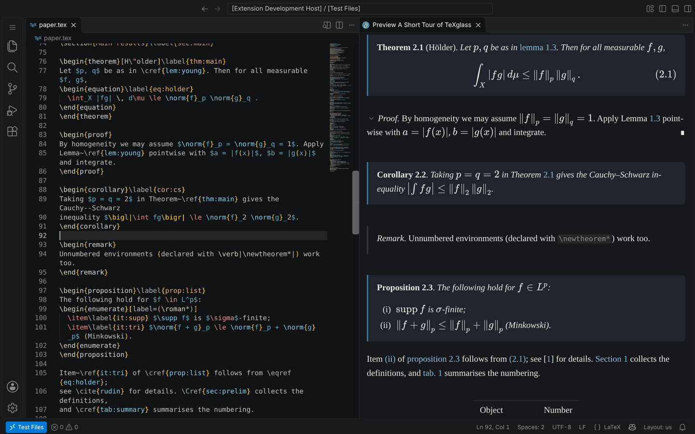
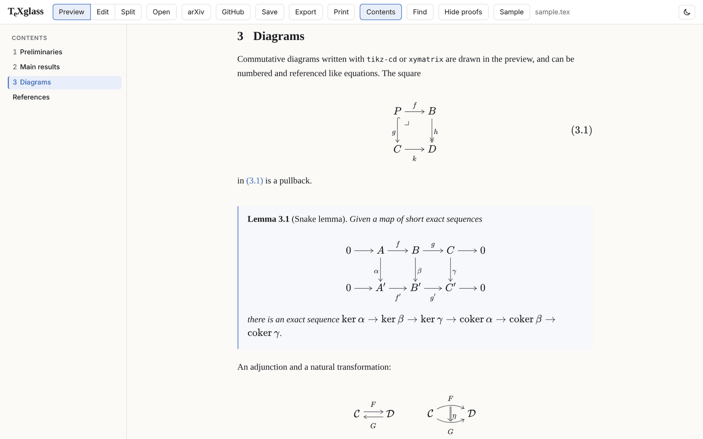
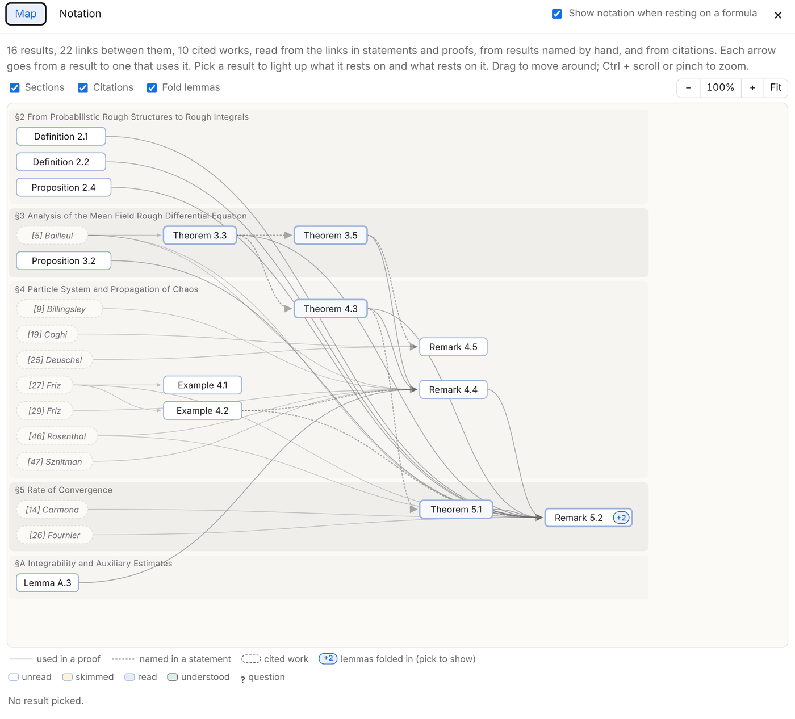

# TeXglass Preview for VS Code

**Read LaTeX like a paper, not like code.** A live preview of your `.tex`
file beside the editor, the way VS Code previews Markdown: math rendered with
[KaTeX](https://katex.org), theorems, equations and sections numbered the way
LaTeX numbers them, and every `\ref`, `\eqref` and `\cref` a link you can
hover. It updates as you type, without saving, and needs no TeX installation.

Then the part a PDF can't do: **What does this use?** lights up everything a
theorem rests on, a **dependency map** shows how the results fit together,
**notation on hover** tells you where a symbol was defined, and **citation
previews** show the cited paper's abstract. Highlight and write notes in the
margin without touching your `.tex` file.

## Get started

1. Install the extension (search for **TeXglass** in the Extensions view, or
   `ext install klepo1.texglass`).
2. Open a `.tex` file and press **Ctrl+K V** (Cmd+K V on a Mac), or click the
   preview icon in the editor's title bar.

The [full guide](https://github.com/klepo0/TeXglass/blob/main/docs/GUIDE.md#vs-code-extension)
lists every feature, command, setting and shortcut.

## Writing with the preview

- **Live, as you type**, beside the editor or in place, and scrolled along
  with the editor both ways.
- **Jump between source and preview**: Ctrl+click or double-click in the
  preview to put the cursor on that spot of the source; **Ctrl+K J** brings
  the spot you are editing to the preview, highlighted.
- **Documents in several files**: `\input`, `\include`, `\subfile`, `\import`
  and `\includeonly`, live across files. Previewing a chapter shows the whole
  document (from `% !TEX root`, subfiles, or the file that includes it).
- **Bibliographies** from `.bib` (BibTeX and biblatex), `.bbl` or amsrefs.
- **Diagrams and figures**: `tikz-cd`, `xymatrix` and TikZ pictures are drawn;
  figures in PNG, JPEG, SVG, GIF, WebP, PDF and EPS are shown, with
  `\graphicspath`.
- **Margin notes**: `\marginpar`, `\marginnote` and `\todo` sit in a margin
  column level with their line, as on paper. **N** / **Shift+N** jump from
  note to note.
- **Live parameters**: with the optional `texglass.sty` (`npx texglass --sty`),
  `\tgparam[2]{p}{1}{4}` gives the preview a slider for `p`; formulas and TikZ
  pictures that use `\p` or `\tgvalue{p}` are redrawn as you drag. The PDF
  shows the start value.
- **Click a formula** to copy its LaTeX.
- **Export to HTML** (one standalone page that works offline), **Export to
  EPUB** (an e-book) and **Print / Save as PDF**, laid out like a paper.
- **texglass.sty** (optional): `\tgdefine`, `\tguses`, `\tgstep` and friends
  tell the preview more about your paper, and LaTeX ignores them. See
  [latex/README.md](https://github.com/klepo0/TeXglass/blob/main/latex/README.md).
- **Fast on long documents**: a 350-page paper converts in a few seconds, in
  a background thread, so typing is never held up.

## Understanding a paper

- **Previews on hover**: rest the pointer on a reference to see the theorem,
  equation or section, and what it uses and where it is used. Citations show
  the bibliography entry, then the cited paper's title and abstract; a
  citation like "[12, Theorem 4.1]" to a paper on arXiv shows Theorem 4.1
  itself.
- **Hypothesis checker**: when a proof says "by Lemma 3.2", the preview lists
  the lemma's hypotheses with boxes to tick as you check each one holds.
- **Notation on hover** and a **notation index**: where each macro and symbol
  was defined, including symbols introduced in words ("let X be"). Search the
  index by meaning, and pin the symbols you keep looking up.
- **Dependency map**: which lemma each theorem uses, grouped by section.
  Press **M** for a larger map you can zoom and drag.
- **What does this use?**: the button by a theorem's heading lights up the
  results it rests on (or, with **Used in**, the ones that rest on it), and
  **Hide the rest** folds everything else away.
- **Navigate**: find in the text (**Ctrl+F**), go to `Lemma 4.1` or `(3.2)`
  (**Ctrl+G**), trace one result, or search by structure with **Uses**: every
  result that uses `Lemma 2` but not `Assumption A`. **Alt+Left** goes back to where you were
  before a jump.
- **Pin** theorems and equations (or a result with everything it uses) and
  show and print only those; drag, hide and add your own links on the
  dependency map.
- **Step through a proof** one piece at a time, like a slide reveal.
- **Fold** sections and proofs, or hide every proof at once.

## Your own highlights and notes

- **Highlight** text in several colours and **write notes** in the margin,
  with LaTeX maths and the document's own macros.
- **Reading progress**: mark each result unread, skimmed, read or understood,
  flag the ones to ask about, and let the Contents tab suggest what to read
  next.
- Everything is kept next to the `.tex` file in `name.texglass.json`; your
  `.tex` is never changed. Notes are anchored to the text, so they stay put
  while you edit.
- **On every machine**: sync them through a private gist on your own GitHub
  account (sign in once, then it syncs automatically), or with VS Code's
  Settings Sync. The TeXglass web viewer and browser extension read the same
  notes.

## Looks

- **Light and dark**, following VS Code's theme or chosen by hand.
- **Handwritten notes look**: the document as notes in ink on squared paper,
  or chalk on a board in dark mode, with a choice of paper, hand and pen.
- **Zoom**, and drag the edge of the text to make the column **wider or
  narrower**. A tabbed side panel (Contents, Map, Notation) on either side.

## In the browser: github.dev and vscode.dev

The extension runs in VS Code for the Web too. On any GitHub repository press
`.` to open it in github.dev, install TeXglass from the Extensions view, open
a `.tex` file and preview it. `\input` files, `.bib` bibliographies and
figures are read straight from the repository. Edit and commit: nothing to
install on your computer.

## Offline and private

The extension works fully offline: KaTeX, its fonts and the handwriting fonts
are bundled. Your files never leave your editor. The only network requests
are the citation lookups on DataCite and Crossref (made only when you hover a
citation, and switchable off), cited theorems fetched from arXiv, and notes
sync to your own gist. The extension counts nothing.

## Also from TeXglass

The same reader runs as a [web viewer](https://klepo0.github.io/TeXglass/)
for arXiv papers, as an arXiv browser extension for Chrome, Edge and Firefox,
and as a command line tool (`npx texglass paper.tex -o paper.html`). See the
[project page](https://github.com/klepo0/TeXglass).

If TeXglass saves you time, you can
[buy it a coffee](https://buymeacoffee.com/texglass).

## Upgrading from an older version

- **From TeXdown Preview** (0.2.0 and earlier): the extension was renamed, so
  uninstall TeXdown Preview after installing TeXglass, or both previews open
  on Ctrl+K V. Your `texdown.scrollSync` and `texdown.previewTheme` settings
  are copied over the first time it runs; keybindings that name `texdown.*`
  commands need the new `texglass.*` names.
- **From 0.7.0 and earlier**: the extension ID changed from `klepo0.texglass`
  to `klepo1.texglass`, so VS Code sees it as a new extension. Uninstall the
  old one (same name, TeXglass Preview; check the ID on its details page).
  Settings, commands and keybindings are unchanged.

Free for noncommercial use under the
[PolyForm Noncommercial License 1.0.0](https://github.com/klepo0/TeXglass/blob/main/LICENSE).
